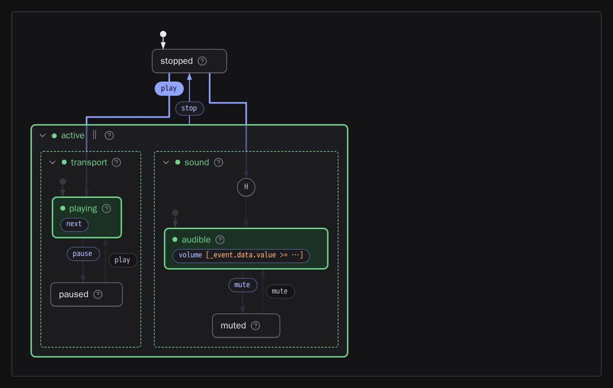

# `<scxml-view>`

`<scxml-view>` draws a whole chart and runs it. States are nested boxes, transitions are
orthogonal arrows, and the active configuration is highlighted. Transitions that just fired light
up. Each transition label is a button that sends its event.

It needs no JavaScript of your own. Import the module once to register the element:

<!-- doctest: html files=traffic-light.scxml -->
```html
<script type="module">import "@tinyactors/scxmljs/view";</script>

<scxml-view src="traffic-light.scxml"></scxml-view>
```



For charts with hundreds of states, or systems of several machines, use
[`<scxml-explorer>`](explorer.md) instead; see [large charts](large-charts.md).

## Where the chart comes from

In order of precedence:

1. The `session` property: a session you created. The element shows it and never starts,
   restarts or disposes it. No engine is loaded.
2. The `source` property: SCXML text.
3. The `src` attribute: a URL, fetched with `fetch()`. Relative `src` attributes inside the chart
   (`<script src>`, `<data src>`, `<invoke src>`) resolve against it.
4. An inline `<script type="application/scxml+xml">` child:

<!-- doctest: html -->
```html
<script type="module">import "@tinyactors/scxmljs/view";</script>

<scxml-view trusted>
  <script type="application/scxml+xml">
    <scxml xmlns="http://www.w3.org/2005/07/scxml" version="1.0" initial="idle">
      <state id="idle"><transition event="go" target="busy"/></state>
      <state id="busy"><transition event="done" target="idle"/></state>
    </scxml>
  </script>
</scxml-view>
```

An inline chart can't contain a `<script>` element: the HTML parser ends the outer
`<script type="application/scxml+xml">` at the inner `</script>`. Use `src` for charts with
scripts (or express the logic with `<assign>` and expressions).

With none of these, the element shows a short hint ("No SCXML to show…") and fires no event: a
framework that creates the element and sets `session` later is the normal case, not an error.

In the cases 2 to 4 the element creates the session itself. It runs the chart in the QuickJS
sandbox unless the element has the `trusted` attribute (see [sandboxed or trusted](sandboxed-vs-trusted.md)).
It loads the engine with a dynamic `import()` when it first needs it. When the element is removed
from the page, it disposes the session it created.

## Attributes

| Attribute | Default | |
|---|---|---|
| `src` | | URL of the chart |
| `trusted` | absent | run the chart in the host's engine instead of the sandbox; only for charts you trust |
| `autostart` | `true` | `"false"` draws the chart without starting the session |
| `interactive` | `true` | `"false"` makes transition labels plain text instead of buttons |
| `data` | | JSON object of initial values; each key replaces the `<data>` element with that id |
| `direction` | `down` | `down` (top to bottom), `right` (left to right), or `auto` (`down` when the element is 760 px wide or less, `right` otherwise) |
| `max-states` | `150` | fold the largest compound states until at most this many boxes are drawn |
| `fit` | absent | scale the diagram all the way down to the element's width instead of panning. Without it, a diagram wider than the element is still scaled down, but not below `--scxml-min-scale` (0.65), and you pan to the rest. Either way this is the automatic zoom; [zooming by hand](#zoom-pan-and-folding) overrides it |
| `event-data` | | JSON object from event names to the data a click on that event's label sends, e.g. `{"login": {"user": "ada"}}`. Host code can also set `detail.data` in an `scxml-send` listener |
| `announce` | `all` | what the live region reads out: `all` (steps and sent events), `sends`, or `off` |
| `warnings` | `show` | `off` hides the list of authoring warnings above the diagram |
| `variables` | absent | list the chart's variables under the diagram, after each step; see [running a chart as a demo](#running-a-chart-as-a-demo) |
| `sends` | | JSON array of `{"event", "data", "label"}`: a button for each, under the diagram, that sends that event with that data (`label` is the button's text, the event's name without it), e.g. `[{"event": "add", "data": {"price": 12}, "label": "Add a pen"}]` |

Changing `src`, `trusted`, `autostart` or `data` loads the chart again with a fresh session.

## Properties

Every attribute has a matching property (`maxStates` for `max-states`). In addition:

| Property | |
|---|---|
| `session` | the session shown. Set it to show a session of your own; set `undefined` to go back to `src` or the inline source. |
| `model` | the compiled chart (read-only) |
| `source` | SCXML text to show instead of `src` |
| `options` | extra `SessionOptions` for sessions the element creates: I/O processors, invokers, a loader… (not `clock`) |
| `clock` | the clock for sessions the element creates. A `PlaybackClock` adds play, pause, step and speed controls. |
| `strings` | translations; see [custom UI and translations](custom-ui.md) |
| `descriptions` | what states are about, for their help buttons: an object from state ids to text, or a function of the state (`undefined` falls back to the chart's comments); see [describing states](#describing-states) |
| `describe(state)` | the text a state's help button shows |
| `zoom` | the diagram's scale (1 = actual size); set a number (0.15–4) to zoom, `null` to go back to the automatic scale |
| `reload()` | load the chart again and start a fresh session |

Setting `options` or `clock` reloads the chart.

<!-- doctest: check -->
```ts
import { PlaybackClock } from "@tinyactors/scxmljs";
import "@tinyactors/scxmljs/view";

const view = document.querySelector("scxml-view")!;
view.clock = new PlaybackClock({ speed: 0.5, playing: false }); // adds playback controls
view.options = {
  invokers: {
    // handles <invoke type="http://example.com/timer">; see the invokers guide
    "http://example.com/timer": () => ({ send() {}, cancel() {} }),
  },
};
```

## Events

All events bubble and cross the shadow boundary.

| Event | `detail` | When |
|---|---|---|
| `scxml-load` | `ViewLoadDetail`: `{ session, model }` | the chart compiled and its session is ready. The element starts the session right after (unless `autostart="false"`), so listeners added now see the first step. |
| `scxml-error` | `ViewErrorDetail`: `{ message, problems?, error }` | nothing to show, the fetch failed, or the chart is invalid. `problems` lists validation problems one per line. The element shows them too. |
| `scxml-send` | `ViewSendDetail`: `{ session, name }` | a transition label is about to send its event. Cancelable: `preventDefault()` stops it. |

<!-- doctest: check -->
```ts
import type { ViewErrorDetail, ViewLoadDetail, ViewSendDetail } from "@tinyactors/scxmljs/view";

const view = document.querySelector("scxml-view")!;
view.addEventListener("scxml-load", (e) => {
  const { session } = (e as CustomEvent<ViewLoadDetail>).detail;
  session.addEventListener("done", () => console.log("finished"));
});
view.addEventListener("scxml-error", (e) => {
  console.error((e as CustomEvent<ViewErrorDetail>).detail.problems);
});
view.addEventListener("scxml-send", (e) => {
  const { name } = (e as CustomEvent<ViewSendDetail>).detail;
  if (name === "delete" && !confirm("Really delete?")) e.preventDefault();
});
```

Use `scxml-load` to reach the session the element created, for example to send events from your
own controls (see [driving charts](driving-charts.md)).

## Zoom, pan and folding

The controls float over the diagram's bottom edge, on one line and inset like the diagram:
playback at the bottom left (with a `PlaybackClock`), zoom at the bottom right. They show only
what's useful at the moment.

```text
[▶] [⏭] [1×]  t = 26.2 s ·············· [−] [65%] [+] [Fit]
```

- **Zoom** with Ctrl or ⌘ and the scroll wheel, a trackpad pinch, or `+`, `-` and `0` (fit to
  width) while the diagram has focus. −, the level (a button that sets 100%) and + appear while
  the pointer is over the diagram, keyboard focus is in it, or you're zooming. Zooming keeps the
  point under the pointer in place, and fixes the canvas at the height it had, so the page
  doesn't jump.
- **Fit** sits in the corner once you've zoomed or panned away, and takes you back to the
  automatic view.
- **Pan** in any direction, past the drawing's edges (some of it always stays in view): drag the
  diagram's background, or use the arrow keys while it has focus (with Shift, further). The
  diagram is a canvas, not a scrolling box: a plain scroll wheel, or a trackpad's two-finger
  swipe, scrolls the page past it, as on an embedded map, and a short hint over the diagram says
  how to zoom instead ("Ctrl + scroll to zoom", ⌘ on a Mac). A double click zooms in on that
  spot, and when you're zoomed in, back to fit.
- **Touch:** one finger scrolls the page (a hint says "Use two fingers to move the diagram"), two
  fingers move the diagram: they pan it and pinch-zoom it, the spot between them staying under them. A double tap zooms in on that spot,
  and when you're zoomed in, back to fit. Buttons are larger, and − and + give way to the
  gestures.
- **Playback** (with a `PlaybackClock`): play or pause, Step (only while paused), the speed (one
  button that cycles through ¼× to 4×) and the virtual time. While the chart plays and nobody
  touches it, the controls shrink to the play button after three seconds; moving the pointer over
  the diagram, a tap or keyboard focus brings them back.
- **Following:** when the chart doesn't fit, the element moves the drawing to the active states,
  and keeps them in view as the machine moves. It stops as soon as you pan or zoom; fit to width
  (`0`) turns it back on.
- **Narrow elements:** parallel regions that wouldn't fit side by side at 65% stack instead, and
  the element lays the chart out again when its width changes a lot.
- **Fold** any compound or parallel state with the chevron before its name: it becomes a single
  box that says how many states it holds. The chevron of a folded box unfolds it.

### Transitions listed in a box

Two kinds of transition aren't drawn as arrows, because they would run long lines across the
chart: a compound state's transitions into its own states ("from anywhere in here", like a global
`cancel`), and transitions that cross three or more container borders. The source state's box
lists them as chips that name their target, like `customer.cancel → cancelling`. Hovering or
focusing a chip outlines the target, and clicking it sends the event like any label.

## Describing states

Every state has a help button (a question mark) after its name. It opens a popover with the
state's kind, its description and its transitions, in the diagram's notation: each event, its
condition after a diamond, and its targets. A target is a link: it flies the view to that state
(zooming out on the way when it's far), marks it for a moment and opens its help, so you can
follow a flow from state to state. With reduced motion it jumps. The description is the XML
comment right before the state, its lines joined into paragraphs (a blank line starts a new one,
a list item keeps its line):

<!-- doctest: scxml -->
```xml
<scxml xmlns="http://www.w3.org/2005/07/scxml" version="1.0" initial="cart">
  <!-- The customer is still choosing. -->
  <state id="cart">
    <transition event="checkout" target="paying"/>
  </state>
  <!-- ── paying: the card form, then the bank's answer ──── -->
  <state id="paying">
    <transition event="paid" target="done"/>
  </state>
  <final id="done"/>
</scxml>
```

A comment documents the element after it, so comments inside a state describe its transitions
or child states, not the state. Divider rules (`── … ────`, `=====`) are left out, and a blank
line inside a comment starts a new paragraph.

To describe states from code instead (or for charts you can't edit), set `descriptions`. It wins
over the comments:

<!-- doctest: check -->
```ts
import "@tinyactors/scxmljs/view";

const view = document.querySelector("scxml-view")!;
view.descriptions = { cart: "The customer is still choosing." };
// or compute them; return undefined to fall back to the chart's comments
view.descriptions = (state) => (state.id.startsWith("pay") ? "Anything to do with money." : undefined);
```

## Large charts

When a chart has more boxes than `max-states`, the element folds the largest compound states into
single boxes, shows a notice, and keeps the active states visible. Unfold a box with its chevron,
or everything with **Expand all** in the notice. See [large charts](large-charts.md).

## Running a chart as a demo

A chart on a page is often there to be tried: the reader sends it events, sees what it does
with its data, and plays the services it talks to. The element does all of it without code:

<!-- doctest: html files=order.scxml -->
```html
<scxml-view src="order.scxml" variables
  sends='[{"event": "order.created", "data": {"id": 7}, "label": "Created, as #7"}]'>
</scxml-view>
```

`order.scxml` sends `order.create` to an `api` processor and waits for `order.created`. The
element lists the request under the diagram, in the `api` stand-in, and the button plays the
service's answer, with the order's id the chart reads (`_event.data.id`).

- **Stand-ins.** A chart that sends to an I/O processor nobody handles (`<send type="payments">`,
  with no `payments` processor in `options.ioprocessors`) would fail each such send with
  `error.communication`. The element gives it a stand-in instead, which keeps what it receives
  and lists it under the diagram, newest first, with when it came and its data. The reader
  plays the service by clicking its reply's label (`order.created`), or a preset send's button. Give a processor of that type in
  `options.ioprocessors` and it replaces the stand-in.
- **`variables`** lists the chart's variables (`session.snapshot()`) after each step.
- **`sends`** puts a button for each preset event under the diagram: the same send as a label's
  click (`scxml-send` first, then the live region), with the data you gave.
- **Restart** (the `rotate-ccw` glyph) sits at the end of that bar whenever it shows, and runs
  the chart again in a fresh session, as `reload()` does.

None of it shows for a session the page hands the element (`session`): the page handles its
processors itself.

## Keyboard and screen readers

- Transition labels are buttons: Tab to them, Enter or Space sends the event.
- The diagram pans with the arrow keys once it has focus (Shift: further); `+`, `-` and `0` zoom.
- Fold toggles and help buttons are buttons too, named "Collapse pay" or "About cart". The help
  popover takes focus; Escape closes it and returns focus to its button.
- With a `PlaybackClock`: Space plays and pauses, `.` steps to the next event.
- A polite live region announces each step ("go: now in busy") and each sent event.
- Colour is never the only signal: active states also get a dot and a bolder border, and the
  accessible name of each box says "active".
- When the session has terminated, the states it ended in stay marked, with the `reached`
  modifier (their accessible name says "reached"): the spec empties the configuration on exit,
  so without it a finished chart would show nothing.
- The diagram's geometry is the same on right-to-left pages; the rest of the element
  (controls, notices, text in labels) follows the page's direction.

## Styling

The element uses the shared `--scxml-*` tokens and exposes these parts:

| Part | Modifiers | |
|---|---|---|
| `frame` | | everything inside the element |
| `canvas` | | the area the diagram pans and zooms in |
| `state` | `atomic` `compound` `parallel` `parallel-region` `final` `history` `collapsed` `active` `reached` | a state's box (`reached`: where a terminated session ended) |
| `state-name` | | the name in a box |
| `transition`, `edge-label` | `live` `fired` | a transition label (a button unless `interactive="false"`) |
| `event`, `cond` | | the event and the condition inside a label |
| `internal` | | a targetless transition listed inside its state's box |
| `edge` | `live` `fired` | an arrow |
| `initial` | | the initial-state marker |
| `expand`, `collapse` | | the fold toggle of a folded / an expanded container |
| `help`, `help-popover`, `go` | | a state's help button, the popover it opens, and a target in it (a link that flies the view there) |
| `portal`, `target` | `live` `fired` | a transition listed in its source's box (with `transition`), and the target it names |
| `empty` | | the hint shown while there's nothing to show |
| `notice` | | the "large chart" notice |
| `send-status` | | what became of an event sent by clicking a label, when it changed nothing or raised an error |
| `error` | | the error panel |
| `warnings`, `warning` | | the authoring-warnings list and each item |
| `controls`, `play`, `step`, `speeds`, `clock` | | the playback controls at the bottom left (with a `PlaybackClock`); `speeds` is one button that cycles |
| `zoom`, `zoom-out`, `zoom-level`, `zoom-in`, `fit` | | the zoom controls at the bottom right: −, the level (sets 100%), +, and back to the automatic view |
| `hint` | | the short hint over the diagram after a plain wheel or a one-finger swipe |
| `run`, `preset-send`, `restart` | | the bar under the diagram: a button for each of `sends`, and restart |
| `panels`, `panel` | `variables` `stand-in` | the panels under the bar: the variables, and what each stand-in received |

`live` marks transitions whose source state is active, `fired` those that fired within the last
second. `--scxml-height` caps the diagram's height (default: none); the run bar and the panels under it add theirs. Details and examples are in
[theming](theming.md).

## Drawing charts yourself

The layout is exported from `@tinyactors/scxmljs/view`. `layoutChart(model.root, options)` takes
a function that measures each box and label, and returns boxes and routed edges in pixels.
`autoCollapse(model.root, maxBoxes)` picks the states to fold. It's pure and deterministic, so you
can draw with SVG, canvas or your framework's components. See [custom UI](custom-ui.md#draw-it-yourself)
and the [API reference](README.md#api-reference).
